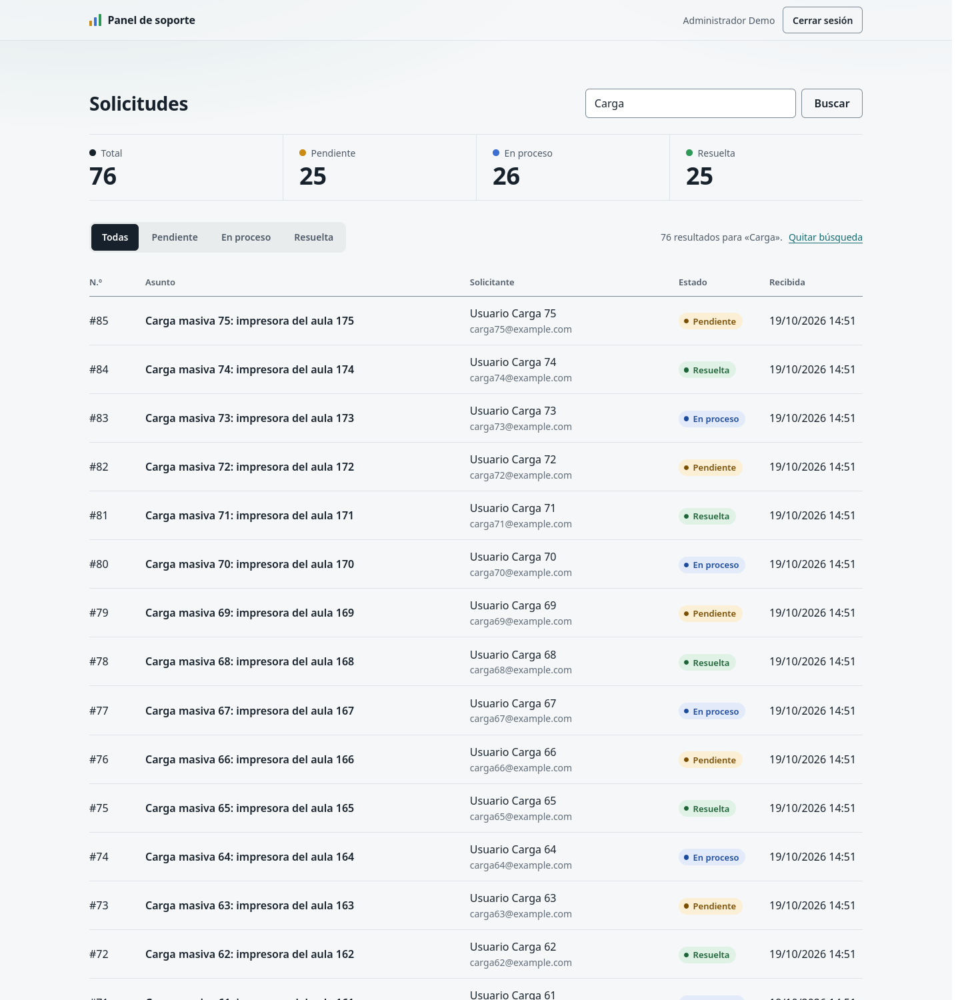
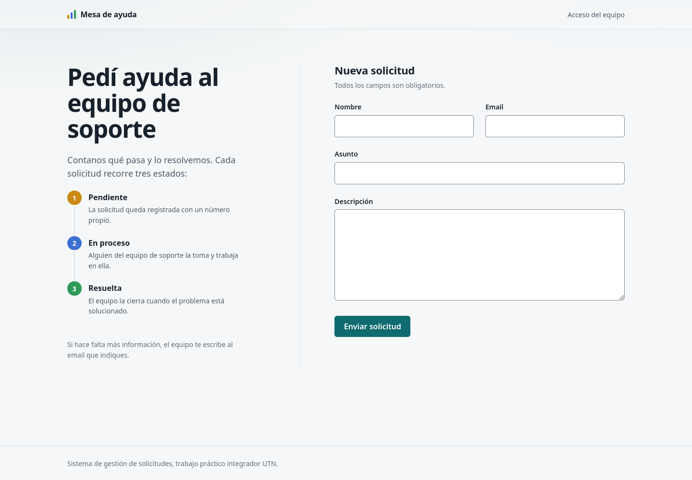
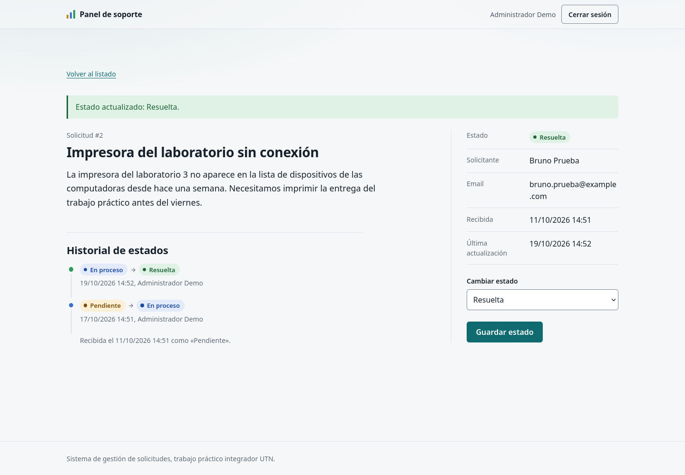
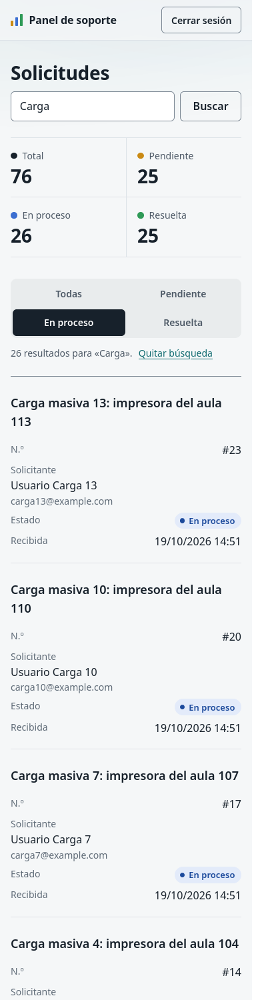

# Sistema de gestión de solicitudes

Trabajo práctico integrador (UTN): sistema de solicitudes de soporte en **PHP + MySQL**,
sin frameworks ni dependencias externas. Está armado como un MVC ligero con front
controller propio y usa consultas preparadas, sesiones endurecidas, protección CSRF y
límite de intentos de login.



## Funcionalidades

**Público**
- Formulario de solicitud (nombre, email, asunto, descripción) con validación server-side
  y mensajes por campo.
- Confirmación con el número de solicitud y el recorrido de estados (patrón POST → redirect → GET).

**Panel administrativo** (`/admin`)
- Login y logout de administrador, con **límite de intentos**: 5 fallos por IP + email
  y 20 por IP en 15 minutos → 429 con `Retry-After`.
- Listado de la más reciente a la más antigua, con **búsqueda** por asunto, nombre, email
  o descripción, **filtro por estado**, **contadores** y **paginación** (20 por página).
- Detalle con cambio de estado e **historial**: quién lo cambió, cuándo y de qué estado a cuál.
- Todas las páginas y operaciones del panel exigen sesión de administrador.

## Requisitos

- PHP **8.2 o superior** con `pdo_mysql` y `mbstring` (para las pruebas, también `curl`).
- **MySQL 8** o **MariaDB 10.6 o superior**.
- No usa Composer, `npm` ni build steps.
- Se desarrolló y probó con PHP 8.5 y MariaDB 11.8. **La compatibilidad con PHP 8.2 y
  MySQL 8.0 no se verifica automáticamente** (no hay CI, D-51). El procedimiento manual con
  contenedores está en [tests/README.md](tests/README.md).

## Instalación local

1. Clonar el repositorio:

   ```bash
   git clone https://github.com/juanisegura/utn-sistema-solicitudes.git
   cd utn-sistema-solicitudes
   ```

2. Crear la base y un usuario propio, como root de MySQL/MariaDB. Reemplazar
   `CAMBIAR_ESTA_PASSWORD`:

   ```sql
   CREATE DATABASE utn_solicitudes CHARACTER SET utf8mb4 COLLATE utf8mb4_unicode_ci;
   CREATE USER 'utn_solicitudes'@'localhost' IDENTIFIED BY 'CAMBIAR_ESTA_PASSWORD';
   GRANT ALL PRIVILEGES ON utn_solicitudes.* TO 'utn_solicitudes'@'localhost';
   ```

   El usuario necesita permisos para crear y borrar tablas, porque el instalador recrea el
   esquema. Si MySQL 8 rechaza la conexión por `127.0.0.1`, crear el mismo usuario también
   para el host `'127.0.0.1'`.

3. Crear la configuración local, que queda fuera de Git
   ([ADR-0007](doc/adr/0007-configuracion-y-secretos.md)):

   ```bash
   cp app/config/config.local.example.php app/config/config.local.php
   ```

   Completar `db.name`, `db.user` y `db.pass`. En desarrollo se puede dejar `env => 'local'`
   y `debug => true`; en cualquier otro entorno, `production` y `false`.

4. Crear las tablas y cargar los datos de prueba:

   ```bash
   php scripts/instalar-db.php
   ```

   El script **borra y recrea** las tablas `admins`, `solicitudes`, `solicitud_eventos` y
   `login_intentos`. Con `--sin-datos` crea solo la estructura.

5. Levantar el servidor de desarrollo desde la raíz del repositorio:

   ```bash
   php -S localhost:8080 -t public_html public_html/index.php
   ```

6. Abrir <http://localhost:8080/> para el formulario y <http://localhost:8080/admin> para el panel.

### Credenciales demo

| Usuario | Contraseña |
|---------|------------|
| `admin@example.com` | `Demo-UTN-2026!` |

Son **solo datos de prueba**. El seed (`database/seed.sql`) contiene únicamente el hash de
esta contraseña, solicitudes ficticias con emails `example.com` y su historial.

**En producción no se carga el seed.** Se usa:

```bash
php scripts/instalar-db.php --sin-datos --force   # con app.env = production exige --force
php scripts/crear-admin.php                       # pide nombre, email y contraseña (mín. 12 caracteres)
```

### Configuración opcional

Además de `env`, `debug` y `db`, `config.local.php` puede reemplazar estos valores. Los
defaults están en `app/config/config.php` y una configuración inválida se rechaza al arrancar.

| Clave (`app.…`) | Default | Para qué |
|---|---|---|
| `session_timeout` | `1800` | Segundos de inactividad antes de vaciar la sesión |
| `login_max_por_cuenta` | `5` | Fallos de login tolerados por IP + email en la ventana |
| `login_max_por_ip` | `20` | Fallos tolerados por IP, sea cual sea el email |
| `login_ventana_seg` | `900` | Ventana del límite de intentos, en segundos |
| `trusted_proxies` | `[]` | IPs o CIDR de proxies propios. Solo desde ellos se usa `X-Forwarded-For` ([ADR-0009](doc/adr/0009-limite-intentos-login.md)) |
| `log_max_bytes` | `1048576` | Tamaño a partir del cual rota `storage/logs/app.log` |
| `log_max_archivos` | `5` | Archivos viejos del log que se conservan |
| `por_pagina` | `20` | Solicitudes por página en el panel |

## Apache

- El **DocumentRoot debe ser `public_html/`**, nunca la raíz del repositorio: así el código
  PHP, la configuración, los scripts y `.git/` quedan fuera del alcance web.
- `public_html/.htaccess` hace varias cosas:
  - envía todo lo que no sea un archivo real al front controller (`mod_rewrite`);
  - desactiva el listado de directorios y bloquea dotfiles;
  - repite los headers de seguridad (`mod_headers`).

  Necesita `AllowOverride All` sobre ese directorio, o al menos `FileInfo`, `Options`,
  `Indexes` y `AuthConfig`.
- El `.htaccess` de la raíz del repositorio contiene `Require all denied`: si por error se
  sirve la raíz, `.git/`, `database/`, `doc/` y `app/` responden 403. Como Apache aplica
  también los `.htaccess` de los directorios padres, `public_html/.htaccess` declara
  `Require all granted` para que ese deny no bloquee el sitio.

## Pruebas

Todo se corre localmente; no hay CI en GitHub (D-51). La forma completa es:

```bash
bash tests/run-all.sh               # sintaxis, unit, instalar-db, integración y smoke (servidor propio en :8090)
bash tests/run-all.sh --evidencia   # además guarda la salida del smoke en doc/pruebas/evidencias/
```

Recrea las tablas, así que hay que correrlo contra una base de desarrollo. No toca el
servidor de `:8080`. Último resultado: 102 tests unitarios, 11 de integración y 84 casos
de smoke, todo OK ([evidencia](doc/pruebas/evidencias/run-all-20261019-155152.txt)).

Cada capa por separado:

```bash
php tests/unit/run.php                                   # unitarios: sin DB ni red
BASE_URL=http://localhost:8080 php tests/integration/run.php   # integración: DB + app en marcha
php scripts/instalar-db.php && bash tests/smoke.sh       # smoke HTTP: exige DB recién instalada
```

La integración necesita un servidor que atienda en paralelo
(`PHP_CLI_SERVER_WORKERS=8 php -S …`) para probar de verdad la concurrencia del límite de
intentos. Qué cubre cada caso: [tests/README.md](tests/README.md) y
[doc/pruebas/PRUEBAS.md](doc/pruebas/PRUEBAS.md).

## Capturas

Desktop y mobile de cada pantalla (formulario, errores, confirmación, login, 429, listado,
búsqueda y paginación, detalle con historial y 404) en
[doc/pruebas/evidencias/capturas/](doc/pruebas/evidencias/capturas/).

| Formulario público | Detalle con historial | Mobile: búsqueda y filtro |
|---|---|---|
|  |  |  |

## Estructura

```text
app/
├── bootstrap.php      arranque: manejo de errores, headers de seguridad, Config, log
├── routes.php         tabla de rutas (método, patrón, controller, auth)
├── autoload.php       autoloader propio App\* → app/
├── config/            config.php (defaults seguros) + config.local.php (fuera de Git)
├── Core/              Router, Request, Response, Session, Csrf, Auth, LoginThrottle, Validator,
│                      View, Config, Log, Database
├── Controllers/       controllers finos, sin SQL (público y Admin/)
├── Models/            único lugar con SQL: Solicitud, SolicitudEvento, Admin, LoginIntento, enum Estado
└── Views/             layouts, formulario, panel, partials y páginas de error (todo escapado con e())
public_html/           único directorio público: index.php (front controller), .htaccess
└── assets/css/        base/ (tokens, reset, global) · layout/ · components/ · pages/
database/              schema.sql (idempotente) y seed.sql (datos ficticios + historial)
scripts/               instalar-db.php y crear-admin.php (solo CLI)
tests/
├── run-all.sh         corrida completa local
├── smoke.sh           pruebas HTTP de la consigna (bash + curl)
├── unit/              tests unitarios (runner propio, sin dependencias)
├── integration/       tests contra DB y servidor (transacción, concurrencia)
└── lib/               runner, procesos hijo y cliente HTTP de los tests
storage/logs/          log de errores con rotación (no versionado)
doc/                   plan, ADRs, resumen técnico, pruebas y registro de uso de IA
tools/                 hook de registro de prompts
```

### Rutas

| Método | Ruta | Descripción | Protección |
|--------|------|-------------|------------|
| GET | `/` | Formulario público | — |
| POST | `/solicitudes` | Alta de solicitud | CSRF |
| GET | `/gracias` | Confirmación (solo tras un alta) | — |
| GET | `/admin/login` | Formulario de login | — |
| POST | `/admin/login` | Login (con límite de intentos) | CSRF |
| POST | `/admin/logout` | Logout | sesión + CSRF |
| GET | `/admin` | Listado (`?estado=…&q=…&pagina=…`) | sesión |
| GET | `/admin/solicitudes/{id}` | Detalle con historial | sesión |
| POST | `/admin/solicitudes/{id}/estado` | Cambio de estado | sesión + CSRF |

## Documentación

- [Plan: alcance, diseño y validación](doc/PLAN.md)
- [Resumen técnico](doc/RESUMEN-TECNICO.md)
- [Decisiones de arquitectura (ADR 0001–0010)](doc/adr/)
- [Pruebas](doc/pruebas/PRUEBAS.md) y [tests/README.md](tests/README.md)
- Uso de IA:
  - [bitácora de prompts](doc/ia/PROMPTS.md)
  - [decisiones](doc/ia/DECISIONES.md)
  - [registro literal](doc/ia/registro/)
  - [revisiones locales](doc/ia/revisiones/)
  - [selección de IA](doc/ia/SELECCION-IA.md)
